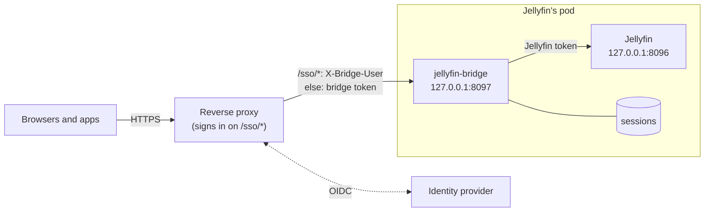

# jellyfin-bridge

Puts [Jellyfin](https://jellyfin.org) behind single sign-on, apps included. It runs in Jellyfin's pod, between the reverse proxy doing the sign-on and Jellyfin: it signs browsers in as the user the sign-on names, signs apps in without Jellyfin's passwords, and hands every client a token of its own, which it swaps for a Jellyfin token on each request. Jellyfin's tokens never leave the pod, never expire on their own, and stop working the moment anything reaches Jellyfin around the bridge.

## Setting it up



The bridge does no OIDC itself: the reverse proxy signs users in and tells the bridge who they are in a header, on `/sso/*` alone. Every other path, `/sso-static/*` included, goes to the bridge without a sign-on, since apps can't do one: their requests carry a bridge token instead. `/sso-static/` holds the pages' scripts and styles, and `bridge.js`, which jellyfin-web loads before anyone has signed in: it's what sends them to `/sso/login`, and, once they sign out, to `/sso/logout`.

1. **The identity provider.** Register an OIDC client for the reverse proxy, its redirect URI under `/sso/` (`/sso/callback` below), and limit it to the users allowed Jellyfin, like a group: without `USERS`, whoever signs in gets the Jellyfin user of the same name.
2. **Jellyfin.** Make the users, with the identity provider's usernames, or map them with `USERS`. Enable Quick Connect in the dashboard's general settings. Have it listen on loopback alone, under Networking, so only the bridge, in the same pod or network namespace, reaches it, and publish no port of its own.
3. **The bridge.** Run it beside Jellyfin, with Jellyfin's `/config` mounted read-write for `JELLYFIN_DB`. It keeps its sessions beside Jellyfin's database, so they're backed up and restored with it.
4. **The reverse proxy.** Send everything to the bridge. On `/sso/*`, sign users in and set `USER_HEADER` to their username, and sign them out on `/sso/logout`, of the identity provider too. Everywhere, remove a client's own `USER_HEADER`. With Caddy and [caddy-pocketid](https://github.com/pdeslaur/caddy-pocketid) 0.4.0 or later, whose client in PocketID has `https://jellyfin.example.com/` among its logout callback URLs:

   ```caddyfile
   jellyfin.example.com {
       request_header -X-Bridge-User

       route /sso/* {
           pocketid_auth {
               issuer        https://id.example.com
               client_id     {$POCKETID_CLIENT_ID}
               client_secret {$POCKETID_CLIENT_SECRET}
               callback_path /sso/callback
               logout_path   /sso/logout
               forward_claim preferred_username X-Bridge-User
           }
           reverse_proxy 127.0.0.1:8097
       }

       reverse_proxy 127.0.0.1:8097
   }
   ```

   Any proxy doing the same works, like oauth2-proxy behind Caddy's `forward_auth` or nginx's `auth_request`. A proxy that can't sign out leaves `/sso/logout` to the bridge, which sends the browser back to jellyfin-web, signed in again.
5. **Signing in.** A browser opening Jellyfin lands on its login page, which the bridge sends to `/sso/login`, through the sign-on. Apps sign in from the account page, `/sso/`, "My devices" in jellyfin-web's menu: by approving their Quick Connect code, there or in jellyfin-web, or, for those asking for a password, with a one-time code as the password.

## How it works

- **Tokens.** Jellyfin's access tokens are opaque strings it looks up, in its devices and then its API keys; nothing outside it can mint one. The bridge gets them from Jellyfin's own API with an API key, logging a device in as any user through Quick Connect, and keeps them in sessions, one per user's device, in a SQLite file of its own. A client gets a bridge token, kept only as its hash.
- **The proxy.** On every request, the bridge removes every token, wherever Jellyfin would read one (the `Authorization` header's `Token`, `X-Emby-Authorization`, `X-Emby-Token`, `X-MediaBrowser-Token`, and `ApiKey` or `api_key` in the query in any case), in Jellyfin's order and with its parsing. If it found a live bridge token, it sends Jellyfin that session's Jellyfin token in an `Authorization` header; otherwise none. A Jellyfin token sent to the bridge reaches Jellyfin as no token at all.
- **Browsers.** `GET /sso/login` names the browser by a device ID it keeps in a cookie, `jellyfin-bridge-device`, makes its session if it has none, and answers a page storing a token for it where jellyfin-web reads its credentials. The bridge adds a script to jellyfin-web's page, `/sso-static/bridge.js`, which refreshes the token before it expires, `REFRESH_BEFORE` ahead, from `POST /sso/session`, and sends jellyfin-web's own login page to `/sso/login`. A browser's tokens last `BROWSER_TTL`; its session, and the Jellyfin token in it, stay across refreshes, and across sign-ins while the cookie lasts.
- **Signing out.** jellyfin-web's sign-out ends the browser's session, and the bridge marks it with a cookie, `jellyfin-bridge-signed-out`: then `bridge.js` sends jellyfin-web's login page to `/sso/logout` rather than `/sso/login`, for the reverse proxy to sign out of the identity provider too. A browser landing on the login page for another reason, its session ended from another device, say, signs in again.
- **jellyfin-web's menu.** The bridge adds "My devices", a link to the account page, to the `menuLinks` of jellyfin-web's `config.json`.
- **Apps.** Their tokens last until revoked. An app with Quick Connect uses Jellyfin's own, its code approved on the account page or in jellyfin-web; the bridge replaces the Jellyfin token in the result with its own. An app asking for a password, like Infuse, takes a one-time code from the account page as the password: the bridge answers `POST /Users/AuthenticateByName` itself, so Jellyfin's passwords never work through it. A code lasts 10 minutes, works once, and is voided after 5 wrong guesses. The obsolete `POST /Users/{id}/Authenticate` and the password resets are refused.
- **The account page.** `/sso/`, "My devices", approves Quick Connect codes, gives one-time codes, and lists the user's sessions, each with a button ending it.
- **Ending sessions.** A session unused for `IDLE` ends: every `SWEEP_EVERY`, the bridge logs its Jellyfin token out and deletes it. Logging out with the token ends it alone, where deleting its device would end every user's tokens on the same device ID, as on a shared browser.
- **Its API key.** At start, it waits for Jellyfin, then writes a random token into Jellyfin's database as the API key `API_KEY_NAME`, replacing the one it wrote before, which Jellyfin reads on each request. The token never leaves the bridge, and its sessions don't depend on it: their Jellyfin tokens are devices'. It refuses to if the `ApiKeys` table's columns aren't the ones it knows. It writes nothing else there: Jellyfin keeps its devices in memory.

## Trust

The reverse proxy in front of it has to sign users in on every path under `/sso/`, and none under `/sso-static/`, and set `USER_HEADER` there, removing a client's own; on other paths, the bridge never reads it. Jellyfin has to listen where only the bridge reaches it, on loopback: anything else in the pod can use the bridge's API key, and anything reaching Jellyfin directly bypasses the bridge. The bridge refuses a `POST` from another site, by its `Sec-Fetch-Site` or `Origin`, with Go's `http.CrossOriginProtection`.

With `USERS`, only the users it maps sign in, as the Jellyfin users it names. Without it, every user the sign-on lets through signs in as the Jellyfin user of the same name, compared without case, so the identity provider decides who gets in. Either way, the bridge creates no Jellyfin user.

## Configuration

| Variable | Default | |
|---|---|---|
| `JELLYFIN_DB` | | Jellyfin's database, like `/config/data/data/jellyfin.db`. Required. |
| `STATE` | `jellyfin-bridge.db` beside `JELLYFIN_DB` | Its own database, of sessions. It has to last across restarts: losing it signs every client out. |
| `ADDR` | `127.0.0.1:8097` | Where it listens: the reverse proxy's upstream. |
| `JELLYFIN_URL` | `http://127.0.0.1:8096` | Jellyfin. |
| `API_KEY_NAME` | `jellyfin-bridge` | Its API key's name in Jellyfin. |
| `USER_HEADER` | `X-Bridge-User` | The header naming the signed-in user on requests to `/sso/`. |
| `USERS` | | The users allowed in and their Jellyfin usernames, like `phil:Phil,anna:Anna`. Without it, everyone the sign-on lets through, as the Jellyfin user of the same name. |
| `BROWSER_TTL` | `8h` | How long a browser's token lasts. |
| `REFRESH_BEFORE` | `1h` | How long before its token expires a browser refreshes it, at most half of `BROWSER_TTL`. |
| `IDLE` | `1080h` | How long a session lasts unused: 45 days. |
| `SWEEP_EVERY` | `1h` | How often it ends idle sessions. |

The bridge tells systemd it's ready, through `NOTIFY_SOCKET`, once it listens.

## Pages

The pages under `/sso/` are Go `html/template` templates in [`internal/jellybridge/web/templates`](../../internal/jellybridge/web/templates), rendered by the bridge, and their files under `/sso-static/` are in [`static`](../../internal/jellybridge/web/static), both embedded as they are: nothing is built. The account page's forms work without JavaScript, and [Unpoly](https://unpoly.com) swaps in the part of the page each one changes, and refreshes the sessions every 10 seconds. `bridge.js`, the script the proxy adds to jellyfin-web, is plain JavaScript: it runs in jellyfin-web's page, beside its own code.

`unpoly.min.js` and `unpoly.min.css` are Unpoly's, from its npm package, with a line naming its version, the package's hash and its license added at the top. Renovate doesn't update them. To update them, download the package's tarball from the npm registry, check its `sha512` against the registry's `dist.integrity`, and copy the two files in the same way.

## Image

`ghcr.io/pdeslaur/jellyfin-bridge`, for `linux/amd64` and `linux/arm64`, tagged `latest` and with the short commit SHA. See [Images](../../README.md#images) for how it's built and how to verify its signature.
