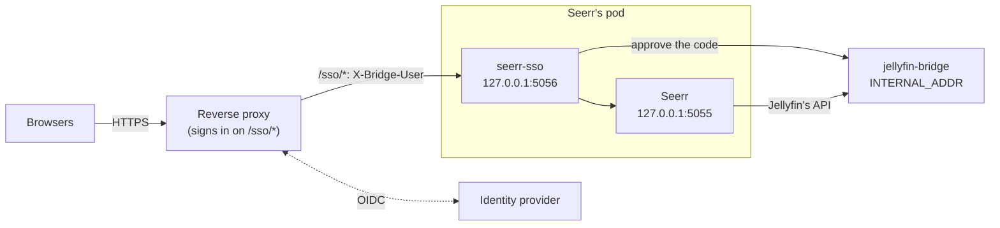

# seerr-sso

Puts [Seerr](https://github.com/seerr-team/seerr) behind single sign-on, for a Jellyfin behind [jellyfin-bridge](../jellyfin-bridge). Seerr has no sign-in of its own for it, but signs Jellyfin users in with Quick Connect: seerr-sso starts that sign-in, has jellyfin-bridge approve its code for the user the sign-on names, and hands the browser Seerr's session.

## Setting it up



1. **jellyfin-bridge.** Set its `INTERNAL_ADDR`, and let only Seerr's pod reach it, like through an mTLS tunnel: whatever does signs in to Jellyfin as any of its users.
2. **Seerr.** Point its Jellyfin server at jellyfin-bridge's internal address, or its public one. For its library sync, its API key has to be a bridge token, since the bridge passes no Jellyfin token to Jellyfin: sign in an app with a one-time code from jellyfin-bridge's account page, as a Jellyfin admin, and use its `AccessToken`. Turn on "Enable Proxy Support" in its network settings, for its secure session cookie; its CSRF protection can be on or off. Import its users from Jellyfin, or enable new Jellyfin sign-ins.
3. **seerr-sso.** Run it in Seerr's pod.
4. **The reverse proxy.** Send everything to seerr-sso. On `/sso/*`, sign users in and set `USER_HEADER` to their username, the one jellyfin-bridge maps, and sign them out on `/sso/logout`, of the identity provider too. Everywhere, remove a client's own `USER_HEADER`. With Caddy and [caddy-pocketid](https://github.com/pdeslaur/caddy-pocketid):

   ```caddyfile
   seerr.example.com {
       request_header -X-Bridge-User

       route /sso/* {
           pocketid_auth {
               issuer        https://id.example.com
               client_id     {$POCKETID_CLIENT_ID}
               client_secret {$POCKETID_CLIENT_SECRET}
               callback_path /sso/callback
               logout_path   /sso/logout
               forward_claim preferred_username X-Bridge-User
           }
           reverse_proxy 127.0.0.1:5056
       }

       reverse_proxy 127.0.0.1:5056
   }
   ```

## How it works

- **Signing in.** Seerr sends a browser without a session to its login page, `/login`, which seerr-sso sends to `/sso/login`, through the sign-on. There, seerr-sso calls Seerr's `POST /api/v1/auth/jellyfin/quickconnect/initiate`, has jellyfin-bridge approve the code for the user, with `POST /bridge/quickconnect`, and calls Seerr's `authenticate` with its secret. Seerr logs in to Jellyfin with it, through jellyfin-bridge, which hands it a bridge token, and answers its session cookie, which seerr-sso passes to the browser, with a page sending it on to Seerr's home page. Seerr's own login page stays at `/login?local`, for a user of Seerr's alone.
- **CSRF protection.** With it on, Seerr sets a CSRF secret, in the `_csrf` cookie, and a token made from it, in `XSRF-TOKEN`, and takes a POST carrying both: seerr-sso gets them from `GET /api/v1/status` first, and sends them on its calls, the token in `X-XSRF-TOKEN`. Seerr's session cookie is then `SameSite=Strict`, which a browser leaves out of a navigation that another site started, redirects included: seerr-sso ends signing in with a page, whose own navigation to Seerr is the site's, rather than one more redirect after the identity provider's. A link to Seerr from another site arrives without the cookie too, and signs in again through `/sso/login`, landing on Seerr's home page.
- **Session length.** Seerr's sessions last 30 days, which it has no setting for. seerr-sso cuts them to `SESSION_DURATION` from their sign-in: with every session cookie Seerr sets, through `/sso/login` or its own sign-in, seerr-sso sets another, `seerr-sso-session`, holding when the session ends and an HMAC binding that time to the session cookie. A request whose session cookie has no such cookie, or a stale, forged or another session's one, reaches Seerr without its session cookie, as though signed out: Seerr sends the browser to sign in again, through `/sso/login`, without a prompt while the sign-on's own session lasts. A stolen session cookie is good no longer than that. The HMAC key is random at each start, so a restart has everyone sign in again.
- **Signing out.** Seerr's sign-out ends its session and logs its Jellyfin token out, ending its bridge session, and seerr-sso marks the browser with a cookie, `seerr-sso-signed-out`: Seerr then sends it to its login page, which seerr-sso sends to `/sso/logout`, for the reverse proxy to sign out of the identity provider too.
- **Everything else** goes to Seerr as it came, with the reverse proxy's `X-Forwarded-*` headers, without `USER_HEADER` or `seerr-sso-session`.

## Configuration

| Variable | Default | |
|---|---|---|
| `BRIDGE_URL` | | jellyfin-bridge's `INTERNAL_ADDR`, like `http://jellyfin:8098`. Required. |
| `ADDR` | `127.0.0.1:5056` | Where it listens: the reverse proxy's upstream. |
| `SEERR_URL` | `http://127.0.0.1:5055` | Seerr. |
| `USER_HEADER` | `X-Bridge-User` | The header naming the signed-in user on requests to `/sso/`. |
| `SESSION_DURATION` | `8h` | How long a Seerr session lasts from its sign-in, like `8h`. `0` leaves Seerr's 30 days. |

It tells systemd it's ready, through `NOTIFY_SOCKET`, once it listens.

## Image

`ghcr.io/pdeslaur/seerr-sso`, for `linux/amd64` and `linux/arm64`, tagged `latest` and with the short commit SHA. See [Images](../../README.md#images) for how it's built and how to verify its signature.
